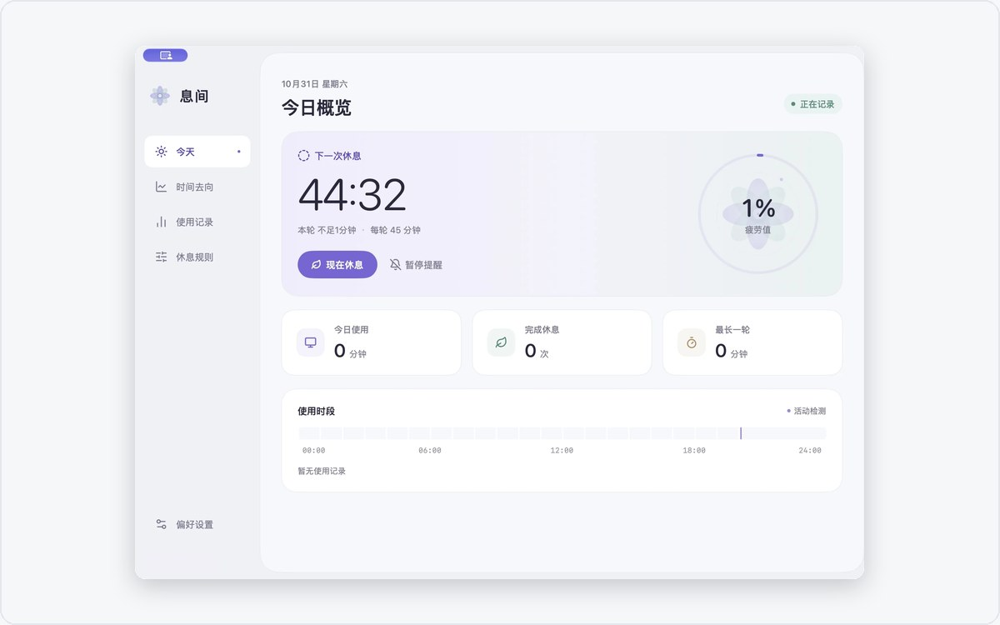
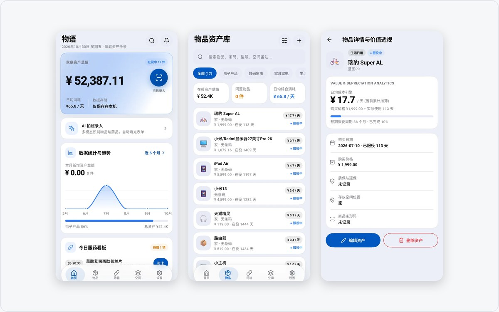
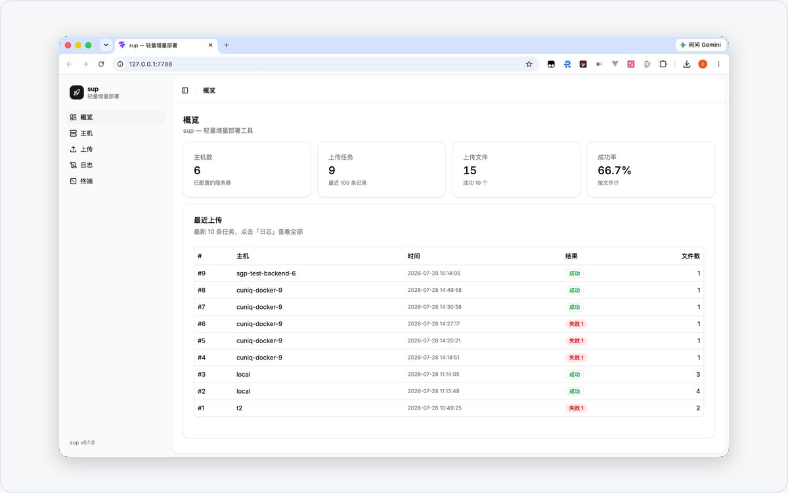
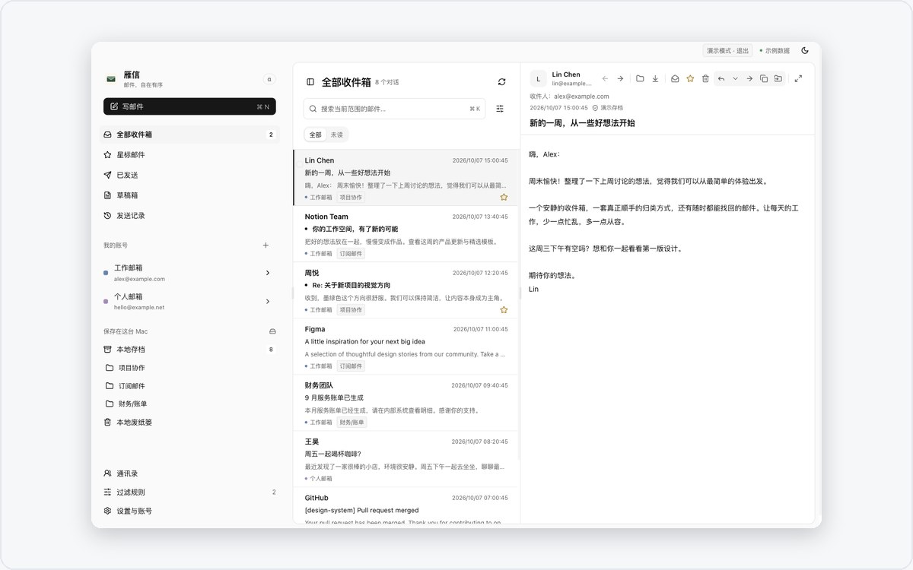
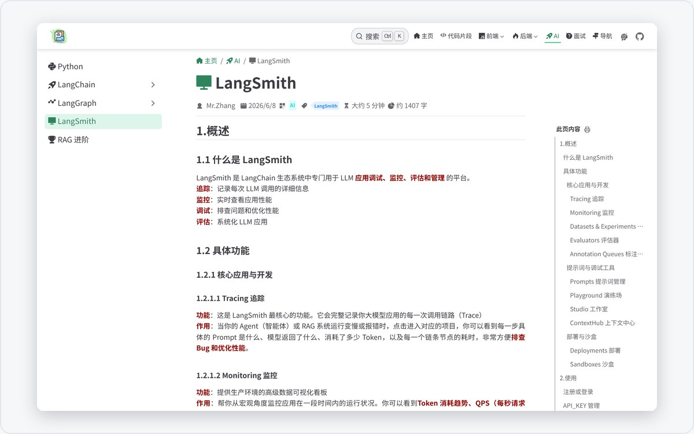

<h1 align="center">yn-zxj</h1>

  <b>Java 后端 · AI Agent 工程化 · 深圳</b> 
  5 年 Java 后端经验 ｜ 近 2 年 RAG 知识库与 Multi-Agent 运维平台内部自研 ｜ 独立交付三个已发布个人项目

  
  
  
  
  
  
  
  
  

---

## 精选项目

<table id="toc">
  <tr>
    <td width="42%" valign="middle">
      <h3>息间 Still</h3>
      原生 macOS 用眼监控、休息提醒与个人跟练，菜单栏常驻，数据完全本地存储
        
      SwiftUI · AppKit · Core Data
    </td>
    <td width="58%" valign="middle" align="center">
      
    </td>
  </tr>
  <tr><td colspan="2">&nbsp;</td></tr>
  <tr>
    <td width="42%" valign="middle">
      <h3>物语 Assetly</h3>
      本地优先的家庭物品、收纳空间与家庭药箱管理，无需账号，离线可用
        
      Flutter · Dart
    </td>
    <td width="58%" valign="middle" align="center">
      
    </td>
  </tr>
  <tr><td colspan="2">&nbsp;</td></tr>
  <tr>
    <td width="42%" valign="middle">
      <h3>sup</h3>
      轻量级远程增量部署工具，单二进制，内置 Web 界面与远程终端
        
      Rust · Axum · React
    </td>
    <td width="58%" valign="middle" align="center">
      
    </td>
  </tr>
  <tr><td colspan="2">&nbsp;</td></tr>
  <tr>
    <td width="42%" valign="middle">
      <h3>雁信 Anser</h3>
      多账号邮件客户端，本地存储与统一收件箱，macOS 已发布
        
      Tauri 2 · Rust · React · TypeScript
    </td>
    <td width="58%" valign="middle" align="center">
      
    </td>
  </tr>
  <tr><td colspan="2">&nbsp;</td></tr>
  <tr>
    <td width="42%" valign="middle">
      <h3>个人博客</h3>
      学习笔记：Java 后端、前端、AI
        
      VuePress 2 · Theme Hope → <a href="https://doc.bt66.cn">doc.bt66.cn</a>
    </td>
    <td width="58%" valign="middle" align="center">
      
    </td>
  </tr>
</table>

更多仓库见 [Repositories](https://github.com/yn-zxj?tab=repositories)。

---

## 技术栈

`Java` `Spring Boot` `MyBatis` `Dubbo` `MySQL` `Redis`  
`Python` `FastAPI` `LangGraph` `RAG` `PostgreSQL / pgvector`  
`Flutter` `SwiftUI` `Tauri` `Rust` `React` `TypeScript` `Node.js`

---

## 联系

[ynzxj@qq.com](mailto:ynzxj@qq.com) · [个人博客](https://doc.bt66.cn) · [GitHub](https://github.com/yn-zxj)
